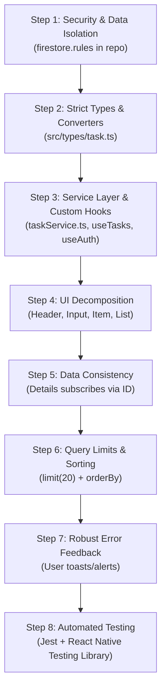

# 🛠️ TaskMaster: Senior Engineering Remediation Plan

A production-grade refactoring blueprint addressing all 9 feedback points from code review.

---

## 📊 Feedback Matrix & Priority

| Area | Observation | Severity | Solution Strategy |
| :--- | :--- | :---: | :--- |
| **Security** | Firestore security rules not demonstrated | **Critical** | Create `firestore.rules` with strict authenticated user authorization |
| **Data Isolation** | Client-side filtering alone is insufficient | **Critical** | Enforce document ownership checks in database rules (`auth.uid == resource.data.userId`) |
| **Architecture** | Main screen handles too many responsibilities | **High** | Decompose `index.tsx` into single-responsibility components |
| **Testing** | No visible automated tests | **High** | Setup Jest + React Native Testing Library with unit & component tests |
| **State Management** | Firebase operations directly inside UI | **Medium** | Extract a Service Layer (`taskService.ts`) & custom hook (`useTasks`) |
| **Data Consistency** | Details receives data via navigation params | **Medium** | Details screen subscribes to document by `id` directly from cloud/cache |
| **TypeScript** | Weak typing on Firebase data | **Medium** | Implement strict interfaces & `FirestoreDataConverter<Task>` |
| **Performance** | No pagination or query limits | **Medium** | Implement query `limit(20)`, sorting by `createdAt`, and pagination structure |
| **Error Handling** | Mostly console logging | **Medium** | Standardize user-facing banner/toast errors and error mapper utility |

---

## 🎯 Step-by-Step Implementation Roadmap

---

## 📌 Detailed Implementation Plan

### Step 1: Security & Data Isolation (Critical)
* **The Problem:** The client does `where('userId', '==', user.uid)`. But without server-side rules, anyone with your `apiKey` can run queries without that `where` clause and download everyone's private tasks!
* **The Fix:**
  * Add `firestore.rules` to the root of the project.
  * Rules enforce:
    * Reading allowed **only** if `request.auth.uid == resource.data.userId`.
    * Creating allowed **only** if `request.auth.uid == request.resource.data.userId`.
    * Updating & Deleting allowed **only** if `request.auth.uid == resource.data.userId`.

---

### Step 2: Strict TypeScript Definitions & Converters (Medium)
* **The Problem:** Data is cast with `doc.data() as Task` or `data: any`.
* **The Fix:**
  * Create `src/types/task.ts` with explicit `Task`, `CreateTaskDTO`, `UpdateTaskDTO`.
  * Use Firestore's built-in **`withConverter(taskConverter)`** so every read and write is strictly type-checked at compile time.

---

### Step 3: Service Layer & Custom Hooks (Medium / High)
* **The Problem:** `index.tsx` directly calls `addDoc`, `updateDoc`, `deleteDoc`, `onSnapshot`, `signInWithEmailAndPassword`, etc.
* **The Fix:**
  * **`src/services/taskService.ts`:** Pure async functions containing only Firestore SDK calls.
  * **`src/hooks/useTasks.ts`:** Hook that manages tasks state, subscriptions, and exposes `{ tasks, loading, error, addTask, toggleTask, deleteTask }`.
  * **`src/hooks/useAuth.ts`:** Hook that exposes `{ user, loading, error, login, signup, logout }`.

---

### Step 4: UI Decomposition (High)
* **The Problem:** `index.tsx` is over 450 lines long and handles user header, inputs, buttons, list rendering, details navigation, and loading states.
* **The Fix:**
  * `src/components/TaskHeader.tsx` (User email & sign-out button)
  * `src/components/TaskInput.tsx` (Input form & validation)
  * `src/components/TaskItem.tsx` (Single memoized task card)
  * `src/app/index.tsx` becomes a clean, concise container orchestrating these subcomponents (~60 lines).

---

### Step 5: Data Consistency in Details Screen (Medium)
* **The Problem:** `details.tsx` reads `title` and `completed` from `useLocalSearchParams()`. If the task is edited or completed elsewhere, the details screen displays **stale, outdated data**.
* **The Fix:**
  * Pass only the `id` in route parameters (`params: { id: task.id }`).
  * `details.tsx` reads the live task either from a `useTask(id)` hook or single-document listener `onSnapshot(doc(db, 'tasks', id))`.

---

### Step 6: Query Limits & Sorting (Medium)
* **The Problem:** Without limits, fetching 10,000 tasks will freeze the app and generate massive Firestore read bills.
* **The Fix:**
  * Add `orderBy('createdAt', 'desc')` and `limit(20)`.
  * Structure pagination support using `startAfter()`.

---

### Step 7: Production Error Handling (Medium)
* **The Problem:** Errors are logged to `console.error` while the user sees nothing if a network request fails.
* **The Fix:**
  * Build a centralized `getErrorMessage(error)` helper.
  * Surface user-visible banners or native alerts (`Alert.alert()`) whenever an operation fails.

---

### Step 8: Automated Testing (High)
* **The Problem:** Zero automated verification.
* **The Fix:**
  * Configure **Jest** and **React Native Testing Library** (`@testing-library/react-native`).
  * Write unit tests for `taskService` / `useTasks`.
  * Write component tests for `TaskItem` (e.g., verifying toggle callback is fired on press).
